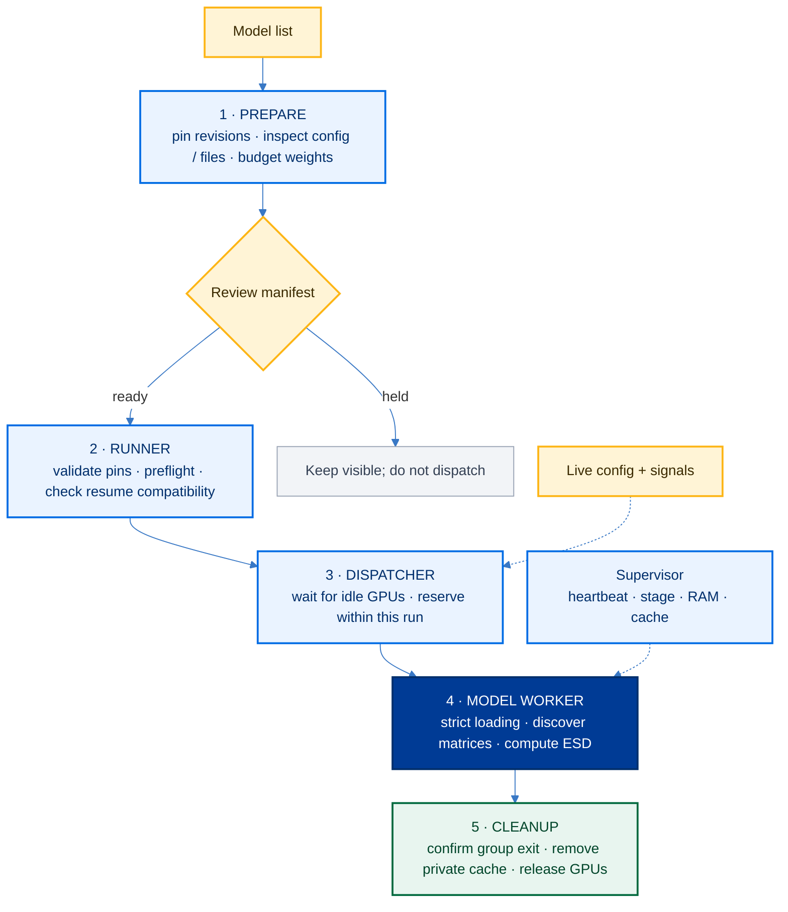
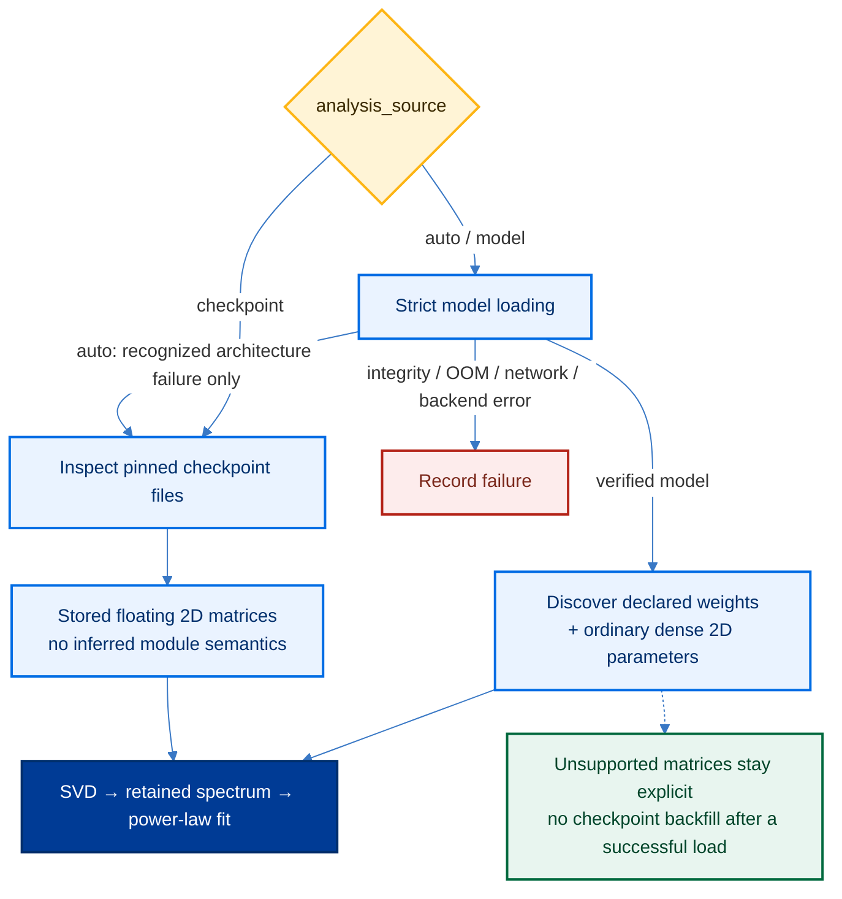

# Model-Zoo

Measure Hugging Face checkpoint spectra with pinned inputs, GPU scheduling,
isolated workers and explicit matrix coverage.

**Prepare → review → run → resume.** Preparation resolves model and adapter-base
revisions before any weights are loaded. The runner then supervises one model
worker by default, with private disposable caches and resource limits.

| Reproducible inputs | Broader matrix discovery | Supervised execution |
| --- | --- | --- |
| Full commit pins, revision-specific config labels and strict loading checks | Declared module weights plus ordinary dense 2D parameters | Idle-GPU checks, worker limits, heartbeats and confirmed process cleanup |

Collection is ready for bounded research runs; 50,000-model operation is not yet
proven. Architecture coverage is not universal support, and spectral descriptors
are not validated model-quality scores.

[Start](#1--create-the-environment) · [Architecture](#how-the-code-fits-together) ·
[GPU scheduling](#gpu-allocation-and-parallelism) · [Controls](#runtime-controls-and-cache-lifecycle) ·
[ESD scope](#measurement-scope)

## 1 · Create the environment

```bash
git clone https://github.com/RpM-Kinshuk/Model-Zoo.git
cd Model-Zoo
conda env create -f environment.yml
conda activate model_zoo
python -m pip install torch==2.11.0 torchvision==0.26.0 --index-url https://download.pytorch.org/whl/cu128
python -m pip install -r requirements.txt
python esd_experiment/tests/test_setup.py
```

Use a new environment; do not update the shared `esd_ind` environment in place.
Conda supplies Python and pip supplies the analysis packages. These are direct
dependency pins, not a full transitive lock; the CUDA wheel pairing follows the
[official PyTorch recipe](https://pytorch.org/get-started/previous-versions/#v2110).
For CPU-only work, use its `cpu` wheel index. The setup check is offline and CPU-only.

Optional quantization backends and the
[clustering dashboard](clustering/unsupervised/README.md) are separate from the
basic collection workflow. Install only what you actually need; a healthy
backend alone does not guarantee a checkpoint can be measured.

For gated/private repositories, supply an authorized token externally:

```bash
export HF_TOKEN="<your-token>"
```

## 2 · Prepare and review a small list

Create `models.csv`:

```csv
model_id
openai-community/gpt2
google/flan-t5-small
```

Adapters may also supply `base_model_relation=adapter` and
`source_model=org/base-model`. Revisions can be given as `org/model@revision`
or in `revision_norm`.

```bash
python esd_experiment/run_experiment.py \
  --model_list models.csv \
  --output_dir analysis_runs/phase2/my_run --limit 5 --prepare_only
```

Preparation downloads metadata and small config/index JSON, not model weights.
Review the generated `models.csv`: pins, config labels, selected weight sizes,
`preparation_status` and `preparation_reason`. Ready rows can launch; held rows
remain visible and are not dispatched.

Launch requires full 40-character model/base commit SHAs. Config labels are
trusted for routing only at their recorded revision. Preparation preserves an
existing `models.csv`; use that manifest to resume, or prepare a fresh directory
for new pins.

For the larger metadata collection, start from
`data/curated/model_zoo_phase2.csv`. Its old labels/ready subsets have known
[limitations](docs/operations/curation.md#architecture-label-caveat); use pinned
config labels rather than guessing model families from names.

## 3 · Run, stop and resume

Run the prepared manifest on GPUs you are allowed to use:

```bash
python esd_experiment/run_experiment.py \
  --model_list analysis_runs/phase2/my_run/models.csv \
  --output_dir analysis_runs/phase2/my_run \
  --gpus 0 1 2 3 --num_gpus_per_job 1 \
  --worker_cache_root /scratch/$USER/model_zoo_worker_cache
```

Start with the defaults: **one worker · 6 GiB selected weights · 16 GiB worker
RAM · 12 GiB private cache**. GPU IDs are physical; the first assigned GPU
becomes local `cuda:0` inside a worker.

Watch progress:

```bash
watch -n 5 'python -m json.tool analysis_runs/phase2/my_run/logs/current_state.json'
```

The snapshot includes the runner PID. Send `SIGUSR1` to drain or `SIGTERM` to
stop and clean up owned workers. See [runtime controls](#runtime-controls-and-cache-lifecycle)
for live configuration, timeout policy and cache cleanup.

Resume with the same launch command, pinned manifest and measurement settings.
Compatible completed pairs are skipped; interrupted models restart, not individual
layers. Failures are retried on a later launch unless `--skip_failed` is set.
Incompatible/incomplete outputs require inspection; use a fresh directory for
changed measurement conventions. `--overwrite` deliberately replaces results.

Ordinary model failures do not stop the queue after successful cleanup.
Status, supervision or unconfirmed cleanup failures stop new dispatch and exit
nonzero. Inspect retained diagnostics/owned processes before resuming in that case.
The local HPC wrapper is `run_script.sh`; its site-specific settings are separate.

## How the code fits together



| Code | Responsibility |
| --- | --- |
| `esd_experiment/src/run_experiment.py` | Preparation, metadata pins, preflight, resume and worker jobs |
| `esd_experiment/gputracker/` | GPU allocation, live config, process ownership, resource checks and cleanup |
| `esd_experiment/src/worker.py` | One model's load → analyze → finalize lifecycle and heartbeat |
| `esd_experiment/src/model_loader.py` | Architecture selection, checkpoint integrity and validated adapter merging |
| `esd_experiment/src/checkpoint_tensors.py` | Stored-matrix analysis without constructing a model |
| `net_esd/` | Matrix discovery, coverage, layer scheduling and spectral computation |

## GPU allocation and parallelism

| Across models | Within a model |
| --- | --- |
| One subprocess and process group per model | Model-mode ESD uses a cost-sorted matrix queue |
| `--max_concurrent_jobs` caps active workers; default **1** | The default thread backend assigns one thread per compute GPU |
| `--num_gpus_per_job` controls the visible device set | Prefers visible GPUs not hosting the model; otherwise reuses the visible pool |
| `CUDA_VISIBLE_DEVICES` maps physical IDs to local CUDA IDs | `--no-parallel_esd` disables parallel layer dispatch |

Before each job, allocation requires memory below `--gpu_memory_threshold`
(default **500 MB**), an empty GPU-process list and no reservation by this run.
The default is **two consecutive checks, five seconds apart**. These are
cooperative checks, not a reservation against another user's processes.

For two simultaneous model workers, each seeing two GPUs:

```bash
python esd_experiment/run_experiment.py \
  --model_list analysis_runs/phase2/my_run/models.csv \
  --output_dir analysis_runs/phase2/my_run \
  --gpus 0 1 2 3 --num_gpus_per_job 2 --max_concurrent_jobs 2 \
  --worker_cache_root /scratch/$USER/model_zoo_worker_cache
```

Increase concurrency after checking model-loading costs. Model sharding and ESD
share the assigned devices; additional visible GPUs do not guarantee enough
analysis memory. Checkpoint mode processes files/matrices sequentially on one
selected device rather than using the model-mode layer thread pool. Explicit
`--analysis_source checkpoint` requires `--num_gpus_per_job 1`.

## Runtime controls and cache lifecycle

| Control | Default / effect |
| --- | --- |
| `--max_weight_gib` | **6 GiB** preparation budget, including adapter bases |
| `--max_worker_ram_gib` | **16 GiB** sampled worker-tree RSS limit |
| `--max_worker_cache_gib` | **12 GiB** sampled private-cache limit |
| `--heartbeat_timeout_seconds` | **3600 s** without a heartbeat |
| `--stage_timeout_seconds` | `load=7200,analyze=28800,save=1800,default=14400` |
| `--stale_process_action` | **`terminate`**; `log` marks a stale worker and keeps waiting |
| `--termination_grace_seconds` | **30 s** after TERM before KILL |

Zero disables a weight/RAM/cache cap, the heartbeat timeout or an individual
stage timeout. The termination grace period must remain at least one second.
RAM/cache limits are sampled, can overshoot and do not predict GPU memory.

| Signal to the runner | Behavior |
| --- | --- |
| `SIGHUP` | Reload `gpu_config.json` at a safe point; invalid reloads retain the previous settings |
| `SIGUSR1` | Drain: launch no more jobs and finish active workers |
| `SIGINT` / `SIGTERM` | Stop dispatch, terminate owned worker groups and finish cleanup |

Live JSON fields include `available_gpus`, `max_concurrent_jobs`,
`memory_threshold_mb`, `max_checks`, resource limits and timeout policy.
Removing a GPU from the pool does not evict an active worker.

Each worker gets `<worker_cache_root>/<run_id>/<worker_id>/`. Hub and legacy
Transformers downloads share the same revision-addressed cache; dataset, Xet
and remote-module caches also stay under that private root. The supervisor
confirms the process group has exited before removing its cache or releasing
its GPUs. Unconfirmed termination retains evidence and stops new dispatch.
To inherit the surrounding shared Hugging Face cache, disable both private-cache
creation and its size limit:

```bash
# Add these together to the launch command:
--worker_cache_root "" --max_worker_cache_gib 0
```

Shared caches are not deleted or counted against the private-cache cap. The RAM
limit and other worker supervision remain active.

## Loading, fallback and retries

Strict loading checks checkpoint keys, shapes and architecture compatibility
before analysis. Missing or mismatched trained weights do not become randomly
initialized replacements. Encoder recovery uses recognized checkpoint layouts;
adapter validation checks the supported LoRA/RSLoRA payload before safe merging.



`auto` falls back once for explicitly recognized architecture-support failures;
`model` disables fallback. Direct checkpoint analysis supports safetensors and
memory-mappable PyTorch ZIP state dicts with `weights_only=True`. It does not
merge adapters, unpack quantized representations or recover a verified model.
See the [exact fallback rules](docs/operations/analysis.md#architecture-independent-checkpoint-matrices).

Once model loading succeeds, analysis stays with that model. Partial or empty
module analysis does not trigger checkpoint fallback, and skipped weights are
not backfilled from checkpoint tensors. A model with no usable spectra fails
explicitly.

Batch workers make one whole-job attempt. The standalone worker exposes
`--max_retries` (default **0**) for classified retryable failures; loader
recovery and automatic checkpoint fallback are separate mechanisms. Relaunching
a batch retries failures unless `--skip_failed` is set.

Remote code is disabled by default. Use `--trust_remote_code` only for reviewed
repositories; same-repository code follows the pinned revision, and cross-repo
code references are rejected.

## Measurement scope

Matrix discovery now includes:

| Matrix family | Interpretation |
| --- | --- |
| Linear, Embedding, HF Conv1D | Whole dense weight matrices, including wide/tall projections |
| Conv1d / Conv2d / Conv3d | Declared kernel slices; not the full convolution operator |
| Built-in MultiheadAttention | Declared fused or separate projection matrices; no synthetic QKV split |
| HF ViT token/position tables | Declared tables with the singleton broadcast axis removed |
| HF Swin relative-position tables | Stored relative-position-by-head matrices, not attention operators |
| Other ordinary dense 2D registered parameters | Exact parameter names, including attributes beyond `.weight` |

Declared weights are visited first; generic discovery does not remeasure their
shared aliases. Unknown higher-dimensional layouts, packed quantization,
adapter factors and parametrization internals are excluded with reasons.
`--filter_type` opts into the older restricted selection and Linear aspect-ratio
skip; **full supported-matrix inclusion is the default**.

### Selection in practice

| Candidate | Default selection | With `--filter_type` |
| --- | --- | --- |
| Ordinary dense 2D parameter such as `custom.extra` | Included under its exact parameter name | Excluded by the legacy selection |
| Linear projection with aspect ratio ≥ 8 | Included whole | Skipped by the legacy aspect-ratio rule |
| Undeclared 3D parameter such as `custom.kernel` | Skipped with a reason | Skipped with a reason |
| Packed or quantized storage helper | No automatic unpacking | No automatic unpacking |

Matrix discovery reads the loaded parameters without changing their values.
It does not guess a tensor layout from its name or invent QKV slices from a
3:1 shape. A stored parameter matrix describes that parameter, not a verified
linear operator.

### Numerical settings

| Measurement option | Default |
| --- | --- |
| `--analysis_source` | `auto` |
| `--load_dtype` | `auto`, checkpoint/framework-selected |
| `--compute_dtype` | `float32`; `float64` for reference checks |
| `--use_svd` | On; CUDA uses `gesvd`. `--no-use_svd` selects Gram eigenvalues |
| `--fix_fingers` | `xmin_mid`; alternatives: `xmin_peak`, `DKS` |
| `--filter_zeros` / `--evals_thresh` | On / absolute threshold `1e-5` |

SVD remains the default because Gram construction can lose small-eigenvalue
accuracy. Upcasting cannot restore precision lost while loading. Missing fits
remain explicit, and successful execution can still have partial matrix coverage.
A finite alpha or small KS distance does not establish power-law behavior or
generalization.

Current conventions are **numerics 7 · loader 10 · matrix selection 4**.
Selection 4 adds generic parameter matrices without changing spectral formulas.
Older selections remain readable but do not resume with selection 4 settings;
use a fresh directory to collect the expanded matrix set.

[Coverage and loader rules](docs/operations/analysis.md#loading-and-coverage) ·
[Metric definitions](docs/operations/analysis.md#interpreting-the-metrics)

## Verification and maintenance

Choose the check that matches the work:

| Check | Purpose |
| --- | --- |
| `python esd_experiment/tests/test_setup.py` | Offline imports and a tiny CPU spectrum; no token access, downloads or GPU use |
| Worker, checkpoint and loader regressions | Matrix selection, fallback boundaries and model-loading behavior |
| Full test suite | Numerical, integrity, coverage, persistence and process-ownership regressions |

```bash
# Run inside the installed model_zoo environment.
python -m pip install 'pytest>=8,<9'

# Focused matrix-selection and fallback regressions:
python -m pytest \
  esd_experiment/tests/test_worker.py \
  esd_experiment/tests/test_checkpoint_tensors.py \
  esd_experiment/tests/test_model_loader.py -q

# Full regression suite:
python -m pytest esd_experiment/tests -q
```

For optional CPU/GPU spectral checks against an independent SciPy float64
reference, see the [validation guide](docs/operations/analysis.md#validation).
These checks are separate from collection and do not establish model quality.

Keep commands, names and helpers simple. Add support for recurring consequential
collection failures, not speculative universal machinery. Keep regression tests
for integrity, numerics, persistence and process ownership; general probes are
not a prerequisite for every collection batch.

Pytest is a development dependency, not a worker requirement. Use
`python esd_experiment/run_experiment.py --help` for the complete CLI reference.

Code: `esd_experiment/src/` loads and runs one model; `gputracker/` supervises
workers; `net_esd/` discovers weights and computes spectra;
`esd_experiment/utils/analyze_results.py` reads/indexes saved results.

[Analysis reference](docs/operations/analysis.md) ·
[Runner code map](esd_experiment/README.md#code-map) ·
[Results and queries](docs/operations/analysis.md#query-models-and-read-a-named-spectrum) ·
[Operations and curation](docs/operations/README.md) · [License](LICENSE)
