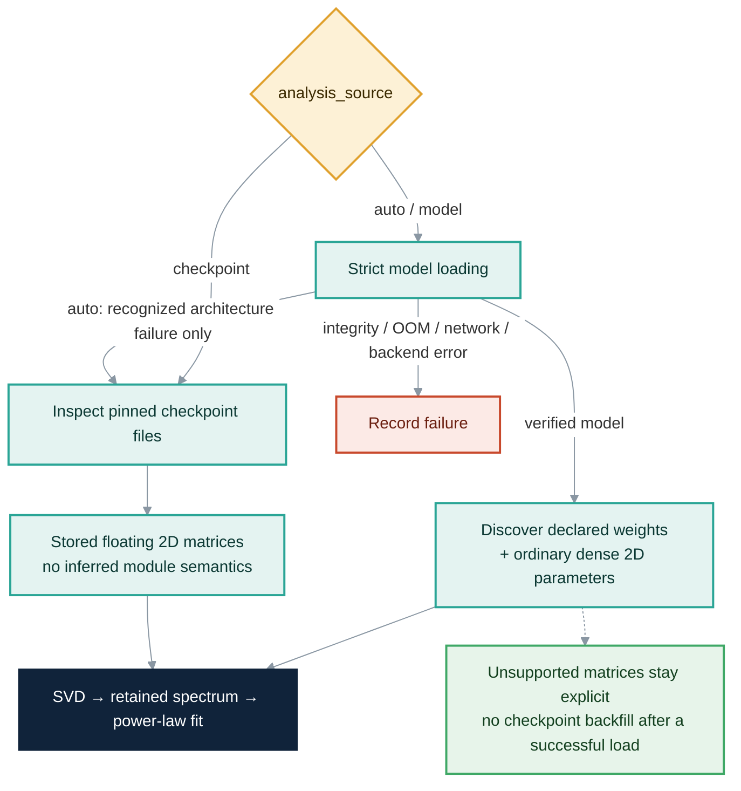

<!-- Workspace research workflow: ../Zoo-Keeper/steering/README.md. One doer + independent review; conda esd_ind in this workspace. -->

<a name="top"></a>

<picture>
  <source media="(prefers-color-scheme: dark)" srcset="docs/assets/hero-dark.svg">
  
</picture>

<p align="center">
The pilot zoo holds <strong>628 models</strong>, <strong>129,623 measured matrix views</strong> and <strong>1,500 lineage records</strong>,<br>
queried offline without weights or GPUs · <a href="docs/operations/zoo.md#recovery-checkpoint-2026-11-04">Validation status</a>
</p>

<table align="center">
<tr>
<td valign="top"><br><a href="#quick-start"><strong>Quick start</strong></a><br><sub>Install, prepare, launch, query</sub></td>
<td valign="top"><br><a href="#architecture"><strong>Architecture</strong></a><br><sub>Plan, own, execute, publish</sub></td>
<td valign="top"><br><a href="#gpu-allocation-and-parallelism"><strong>GPU parallelism</strong></a><br><sub>Pools, workers, layer threads</sub></td>
<td valign="top"><br><a href="#runtime-controls-and-cache-lifecycle"><strong>Runtime controls</strong></a><br><sub>Signals, limits and caches</sub></td>
</tr>
<tr>
<td valign="top"><br><a href="#measurement-scope"><strong>Spectra</strong></a><br><sub>The fit, coverage, numerics</sub></td>
<td valign="top"><br><a href="#evidence-and-zoo"><strong>Fingerprints</strong></a><br><sub>Sketches, hashes, lineage</sub></td>
<td valign="top"><br><a href="#the-zoo"><strong>The zoo</strong></a><br><sub>Packages, tables, queries</sub></td>
<td valign="top"><br><a href="#verification-and-maintenance"><strong>Verification</strong></a><br><sub>Tests and reference guides</sub></td>
</tr>
</table>

<a name="what-it-measures"></a>

## What one run measures

<picture>
  <source media="(prefers-color-scheme: dark)" srcset="docs/assets/measure-dark.svg">
  
</picture>

- **What it does:** pins Hugging Face checkpoints to exact commits, measures the spectrum of every supported weight matrix on shared GPUs, fingerprints the same weights for lineage, and publishes the results as one queryable zoo.
- **Who it is for:** researchers collecting spectral and lineage measurements across many models on shared multi-GPU servers.
- **What it keeps honest:** every number stays attached to its commit, matrix and measurement conventions; unmeasured matrices keep explicit reasons; GPUs return to the pool only after confirmed cleanup.

<a name="quick-start"></a>
<a name="start-a-run"></a>

##  Quick start

*List, prepare, launch, query.* The defaults are the intended behavior: one model
worker, automatic budgets, evidence and package publishing on.

<picture>
  <source media="(prefers-color-scheme: dark)" srcset="docs/assets/terminal-dark.svg">
  
</picture>

<a name="install"></a>

### 1. Install

```bash
git clone https://github.com/RpM-Kinshuk/Model-Zoo.git
cd Model-Zoo
conda env create -f environment.yml
conda activate model_zoo
python -m pip install torch==2.11.0 torchvision==0.26.0 --index-url https://download.pytorch.org/whl/cu128
python -m pip install -r requirements.txt
python esd_experiment/tests/test_setup.py
```

The last command is an offline, CPU-only check: imports and a tiny spectrum,
without a token, downloads or GPU use.

<details>
<summary><strong>Environment notes</strong> · CUDA pairing, CPU-only work and optional backends</summary>

Use a fresh environment; preserve the shared `esd_ind` installation.
Conda supplies Python; pip installs the directly pinned analysis dependencies.
This is not a full transitive lock. The CUDA pairing follows the
[official PyTorch recipe](https://pytorch.org/get-started/previous-versions/#v2110);
use its `cpu` wheel index for CPU-only work.

Optional quantization backends and the
[clustering dashboard](clustering/unsupervised/README.md) are separate installs.
An importable backend does not guarantee a checkpoint can be measured.

</details>

### 2. List the models

Create `models.csv` with one Hugging Face ID per row, then set two paths:

```csv
model_id
openai-community/gpt2
google/flan-t5-small
```

```bash
export HF_TOKEN="<your-token>"      # gated or private repositories
export ZOO_DATA=/path/to/zoo-data   # packages, parent-block cache and zoo builds
```

Without `ZOO_DATA`, packages go to `<output_dir>/packages` and the zoo build
needs `--data_root`.

<details>
<summary><strong>List options</strong> · Revisions, adapters and curated collections</summary>

Preparation accepts `org/model@revision` or a `revision_norm` column and
resolves them to full commit pins. For an adapter, supply
`base_model_relation=adapter` and preferably `source_model=org/base-model`.

For larger collections, start from `data/curated/model_zoo_phase2.csv`.
Imported family labels and old ready subsets have known
[limitations](docs/operations/curation.md#architecture-label-caveat);
prefer pinned config evidence over names.

</details>

### 3. Prepare and review

```bash
python esd_experiment/run_experiment.py \
  --model_list models.csv \
  --output_dir analysis_runs/phase2/my_run --limit 5 --prepare_only
```

> [!NOTE]
> **Review before launch.** Open `analysis_runs/phase2/my_run/models.csv`. Ready rows
> launch; held rows stay visible with a `preparation_reason` and are never dispatched.
> Preparation reads metadata, small JSON files and selected safetensors headers,
> not tensor values, and uses no GPU.

<details>
<summary><strong>Preparation notes</strong> · Pins, held rows and weight budgets</summary>

Launch requires full 40-character model and adapter-base commit SHAs.
Inspect `preparation_status` and `preparation_reason` before starting.

Config labels are trusted for routing only at their recorded revision.
Preparation preserves an existing `models.csv`; resume with it or prepare a
fresh directory for new pins. Preparation reviews selected file sizes and access
without probing GPUs. At launch, `--max_weight_gib auto` uses the selected pool's
capacity, including adapter bases; `0` disables its size cap. Old size-only holds
are reconsidered when the new budget permits; access/layout holds remain held.

</details>

### 4. Launch

```bash
python esd_experiment/run_experiment.py \
  --model_list analysis_runs/phase2/my_run/models.csv \
  --output_dir analysis_runs/phase2/my_run \
  --gpus 0 1 2 3 \
  --worker_cache_root /scratch/$USER/model_zoo_worker_cache

python esd_experiment/analyze_results.py --results_dir analysis_runs/phase2/my_run
```

One model worker at a time draws GPUs from the pool you name, sized from its
weights. While the GPUs compute spectra, a CPU sidecar fingerprints the same
downloaded files, and each finished model publishes one package. Point
`--worker_cache_root` at fast local disk; private caches are deleted after
confirmed exit. The second command indexes the run into `summary.csv`; filter on
both `outcome` and `matrix_coverage` before comparing models.

> [!TIP]
> **Continue where you left off.** Relaunch with the same pins and settings;
> compatible completed work is skipped. `run_script.sh` is the site-specific HPC
> wrapper with every default spelled out.

<details>
<summary><strong>Launch options</strong> · Evidence, publishing and opt-outs</summary>

Full-mode runs write pinned evidence under `evidence/<safe>/`: fingerprints
of full tensors and sampled 128/256/512-row blocks, full spectra, and declared-parent deltas.
Evidence runs on CPU alongside GPU analysis by default. Use `--no-evidence` for
the previous CSV/H5-only behavior; checkpoint mode disables evidence with a notice.
If evidence fails, the ESD pair is retained and the next run retries evidence only.

Completed models publish immutable packages to `$ZOO_DATA/packages`, or
`<output_dir>/packages` when `ZOO_DATA` is unset. Set `--packages_root PATH` or
use `--no-publish` to retain only run-folder outputs. Models too large for full
mode receive [row-block evidence](#oversized-models) after the full-mode queue.

</details>

### 5. Build and query the zoo

```bash
python -m zoo.cli build
```

The build reads current-convention packages from `$ZOO_DATA/packages` and
atomically publishes `$ZOO_DATA/builds/current`: Parquet tables, a retrieval
index and links to full HDF5 spectra. Query it offline, without weights or GPUs,
from a [Zoo-Keeper](https://github.com/RpM-Kinshuk/Zoo-Keeper) checkout beside
Model-Zoo:

```bash
python -m pip install -e . duckdb==1.5.6   # once: Zoo-Keeper imports zoo/ and evidence/
cd ../Zoo-Keeper
python -m zoo_keeper.cli find --text gpt2 --limit 10
python -m zoo_keeper.cli similar openai-community/gpt2 -k 5
```

<a name="what-a-run-writes"></a>

### What a run writes

```text
analysis_runs/phase2/my_run/
├── models.csv              pinned list: ready/held status, sizes, config labels
├── stats/<model>.csv       per-layer scalars: alpha, fit quality, rank
├── metrics/<model>.h5      full spectra (/eigs), fits (/layers), coverage
├── evidence/<safe>/        manifest, fingerprints, full spectra, parent deltas
├── summary.csv             per-model index, written by analyze_results.py
├── oversized_models.csv    models routed to row-block-only evidence, if any
├── gpu_config.json         live policy; edit it, then send SIGHUP
└── logs/                   current_state.json, terminal_status/, failure records

$ZOO_DATA/
├── packages/               one immutable package per model and convention
├── cache/parent-blocks/    disposable parent row blocks; never published
└── builds/current/         the zoo snapshot that queries read
```

The CSV/HDF5 pairs are authoritative; `summary.csv` and the zoo are rebuildable
views of them. See [reading a run](docs/operations/analysis.md#reading-a-run)
for every `outcome` and coverage field.

<a name="architecture"></a>

##  Architecture

*Plan, own resources, execute, publish.* Supervision stays active through cleanup.

<picture>
  <source media="(prefers-color-scheme: dark)" srcset="docs/assets/architecture-dark.svg">
  
</picture>

The runner decides what runs, the dispatcher decides where and when, and each
worker owns exactly one model. A package is published before the worker exits;
GPUs return to the pool only after the worker's process group has exited and its
private cache is gone.

<details>
<summary><strong>Source map</strong> · Files and responsibilities</summary>

| Code | Owns |
| --- | --- |
| `esd_experiment/src/run_experiment.py` | Preparation, metadata pins, preflight, resume, worker jobs and oversized-model routing |
| `esd_experiment/src/sizing.py` · `prefetch.py` | Automatic per-job budgets; bounded download-ahead into future workers' caches |
| `esd_experiment/gputracker/` | GPU allocation, live config, process groups, resource checks and cleanup |
| `esd_experiment/src/worker.py` | One model's load → analyze → finalize lifecycle, heartbeat and package publication |
| `esd_experiment/src/model_loader.py` | Architecture selection, checkpoint integrity and validated adapter merging |
| `esd_experiment/src/checkpoint_tensors.py` | Stored-matrix analysis without constructing a model |
| `esd_experiment/src/evidence_bridge.py` | Evidence sidecar setup, completion checks and publishing for runner jobs |
| `esd_experiment/src/oversized_model_worker.py` | Supervised row-block evidence for models too large for full mode |
| `net_esd/` | Matrix discovery, coverage, layer scheduling and spectral computation |
| `evidence/` | Manifests, fingerprints, row-block sketches, parent deltas, the CPU sidecar and the evidence CLI |
| `zoo/` | Package publication, the zoo build, lineage, retrieval and the candidate-pair delta pass |

The [runner source map](esd_experiment/README.md#code-map) lists entrypoints and
implementation boundaries.

</details>

<a name="gpu-allocation-and-parallelism"></a>

##  GPU allocation and parallelism

*Across models and within a model.* Separate processes own devices; layer threads share the work.

<picture>
  <source media="(prefers-color-scheme: dark)" srcset="docs/assets/gpus-dark.svg">
  
</picture>

| Pool | Devices per model | Models at once |
| --- | --- | --- |
| `--gpus 0 1 2 3` | `--num_gpus_per_job 2` | `--max_concurrent_jobs 2` |

> [!TIP]
> **Start small.** The launch default is **one worker**, with **automatic GPUs per model**.
> The figure shows a larger configuration. Admission requires two idle checks,
> five seconds apart: no GPU processes and memory below 500 MB.

<details>
<summary><strong>Tune the parallelism</strong> · Allocation, threads and a multi-GPU launch</summary>

Physical GPU IDs become local CUDA IDs through `CUDA_VISIBLE_DEVICES`.
The dispatcher reserves devices within this run. Idle checks are cooperative;
another user's job can start afterward.

`--cpu_threads_per_gpu auto` divides CPU cores by the physical GPU count and
multiplies that budget by the GPUs assigned to each worker. The dispatcher sets
OMP, MKL, OpenBLAS and NumExpr thread limits before launching the worker. Set an
integer to override, or `0` to preserve the inherited environment. Editing this
field in `gpu_config.json` affects subsequent workers.

`--gpu_memory_threshold` changes the used-memory threshold and `--max_check`
changes the number of consecutive checks. Model mode cost-sorts matrices and
uses one fixed-device thread per compute GPU. It prefers visible devices not
hosting the model, otherwise reuses the visible pool. Disable layer parallelism
with `--no-parallel_esd`. The library API also offers a spawned-process backend.

Evidence runs on the worker's CPU budget beside the GPU threads.
`--evidence_device gpu` moves it to the worker's first visible GPU instead;
`--evidence_max_inflight_gib` (default 2) bounds its in-flight weight bytes.

For two simultaneous model workers, each seeing two GPUs:

```bash
python esd_experiment/run_experiment.py \
  --model_list analysis_runs/phase2/my_run/models.csv \
  --output_dir analysis_runs/phase2/my_run \
  --gpus 0 1 2 3 --num_gpus_per_job 2 --max_concurrent_jobs 2 \
  --worker_cache_root /scratch/$USER/model_zoo_worker_cache
```

Model sharding and spectral computation share assigned devices. More visible
GPUs do not guarantee enough analysis memory; review actual costs before
increasing concurrency. Checkpoint mode processes files/matrices sequentially
on one selected device. Explicit `--analysis_source checkpoint` requires
`--num_gpus_per_job 1`.

</details>

<a name="runtime-controls-and-cache-lifecycle"></a>

##  Runtime controls and cache lifecycle

*A live run stays steerable.* Change policy, drain the queue or stop with supervised cleanup.

<picture>
  <source media="(prefers-color-scheme: dark)" srcset="docs/assets/lifecycle-dark.svg">
  
</picture>

Send signals to the runner. Its PID is `runner_pid` in `logs/current_state.json`:

```bash
RUN=analysis_runs/phase2/my_run
PID=$(python -c "import json, sys; print(json.load(open(sys.argv[1]))['runner_pid'])" "$RUN/logs/current_state.json")
kill -HUP "$PID"    # after editing $RUN/gpu_config.json
```

| Goal | Signal | What happens |
| --- | --- | --- |
| Reload policy | `kill -HUP` | Rereads `gpu_config.json` at a safe point; an invalid file keeps the previous settings |
| Finish active work | `kill -USR1` | Stops dispatching new models; running workers complete |
| Stop and clean up | `kill -INT` or `kill -TERM` | Terminates worker groups, confirms exit, then removes caches and releases GPUs |

| Bound | Default | Checked as |
| --- | --- | --- |
| Selected weights | Pool capacity, including adapter-base weights | Reviewed download sizes |
| Worker RAM | Automatic, at least 16 GiB | Sampled process-tree RSS |
| Private cache | Automatic | Sampled allocated disk usage |

Every bound is configurable per run. RAM and cache can overshoot between samples.

<details>
<summary><strong>Operate the run</strong> · Live state, limits, timeouts and cache ownership</summary>

```bash
watch -n 5 'python -m json.tool analysis_runs/phase2/my_run/logs/current_state.json'
```

The snapshot includes the runner PID, worker state, stages, GPUs, process
groups, heartbeat data and cache/log paths.

| Control | Default |
| --- | --- |
| `--max_weight_gib` | `auto`: selected GPU pool capacity / 1.5; includes adapter base |
| `--max_worker_ram_gib` | `auto`: max(16, 0.5 × weight GiB + 4), plus any evidence buffer above 2 GiB |
| `--max_worker_cache_gib` | `auto`: 1.1 × selected weight GiB + 2 |
| `--heartbeat_timeout_seconds` | 3600 s without a heartbeat |
| `--stage_timeout_seconds` | `auto`: analyze/fingerprint max(28800, 600 × weight GiB); load 7200, save 1800, default 14400 |
| `--stale_process_action` | `terminate`; `log` marks stale workers and keeps waiting |
| `--termination_grace_seconds` | 30 s after TERM before KILL |

Zero disables a weight/RAM/cache cap, the heartbeat timeout or an individual
stage timeout. The termination grace period must be at least one second.
RAM/cache checks can overshoot between samples and do not predict GPU memory.
Heartbeat age detects a stopped reporter; stage age catches foreground work
that is stuck while its reporter remains alive.

Edit `gpu_config.json` and send `SIGHUP` to reload at a safe point. Invalid
reloads retain the previous settings. Live fields include `available_gpus`,
`max_concurrent_jobs`, `memory_threshold_mb`, `max_checks`, resource limits
and timeout policy. Positive per-job automatic limits take precedence over global
caps; explicit CLI caps use the live globals. Removing a GPU from the pool does not evict its worker.

Automatic GPU allocation is ceil(1.5 × selected weight bytes / the smallest
selected GPU's total memory), within the supplied pool. Use
`--num_gpus_per_job N` to fix the allocation. Checkpoint mode keeps one GPU.
Sizing requires reviewed `download_bytes`; reprepare old lists missing it.
These are initial heuristics, pending live throughput validation.

Download-ahead stages up to one model per pool GPU, bounded by
`--prefetch_max_gib 64`, before reserving GPUs. Only pinned selected weights and
loader metadata enter future workers' private caches. Failed prefetch falls
back to worker downloads. Set `--prefetch_models 0` to disable it. The default
cache root is `$MODEL_ZOO_WORKER_CACHE_ROOT`, else `/scratch/$USER/hf_worker_cache`.

Each private cache lives at `<worker_cache_root>/<run_id>/<worker_id>/`.
Hub and legacy Transformers downloads share revision-addressed storage;
dataset, Xet and remote-module caches stay under the same private root.
Cleanup confirms worker-group exit before removing the cache and releasing GPUs.
Unconfirmed termination retains evidence and stops dispatch.

To inherit a shared Hugging Face cache, add both options to the launch command:

```bash
--worker_cache_root "" --max_worker_cache_gib 0
```

Shared caches are neither deleted nor counted against the private-cache limit.
RAM and other supervision remain active.

</details>

<details>
<summary><strong>Recover and resume</strong> · Failure boundaries and retry behavior</summary>

Compatible completed pairs are skipped. Interrupted models restart from the
model boundary, not an individual layer. Resume requires the same manifest,
pins and measurement settings. Incompatible/incomplete outputs require
inspection; use a fresh directory for changed conventions.
`--overwrite` deliberately replaces selected results.

Batch workers make one whole-job attempt. The standalone worker exposes
`--max_retries` (default 0) for classified retryable failures. Loader recovery
and checkpoint fallback are separate mechanisms. Relaunching retries failures
unless `--skip_failed` is set.

Ordinary model failures allow the queue to continue after successful cleanup.
Status, supervision or unconfirmed cleanup failures stop new dispatch and exit
nonzero. Inspect retained diagnostics and owned processes before resuming.
Allow signal-triggered cleanup to finish; avoid killing the runner with SIGKILL.

</details>

<a name="measurement-scope"></a>

##  Measurement scope

*Weights, singular values, spectrum.* Explicit matrix coverage gives the numbers context.

<picture>
  <source media="(prefers-color-scheme: dark)" srcset="docs/assets/spectrum-dark.svg">
  
</picture>

Each supported matrix $W$ contributes its eigenvalues $\lambda_i = \sigma_i(W)^2$.
Above the cutoff $\lambda_{\min}$, the median retained eigenvalue by default,
the tail is fitted with a power law $p(\lambda) \propto \lambda^{-\alpha}$ by maximum likelihood,
where $n$ counts the tail eigenvalues and $F_n$ is their empirical distribution:

```math
\hat\alpha \;=\; 1 + n \Bigg/ \sum_{\lambda_i \ge \lambda_{\min}} \ln\frac{\lambda_i}{\lambda_{\min}},
\qquad
D \;=\; \sup_{\lambda \ge \lambda_{\min}} \big|\,F_n(\lambda) - F_{\hat\alpha}(\lambda)\,\big|
```

| Decompose | Compute | Fit the tail |
| --- | --- | --- |
| **SVD** by default | **float32** arithmetic | **Midpoint** cutoff |

Declared module weights and ordinary dense 2D parameters are measured.
Unsupported representations retain explicit reasons.

<details>
<summary><strong>Know the coverage</strong> · Included matrices and explicit exclusions</summary>

| Matrix family | Interpretation |
| --- | --- |
| Linear, Embedding, HF Conv1D | Whole dense matrices, including wide/tall projections |
| Conv1d / Conv2d / Conv3d | Declared kernel slices, not the full convolution operator |
| Built-in MultiheadAttention | Declared fused or separate projections; no synthetic QKV split |
| HF ViT token/position tables | Declared tables with the singleton broadcast axis removed |
| HF Swin relative-position tables | Stored relative-position-by-head matrices, not attention operators |
| Other ordinary dense 2D registered parameters | Exact parameter names, including attributes beyond `.weight` |

Declared weights are visited first; generic discovery does not remeasure their
shared aliases. Unknown higher-dimensional layouts, packed quantization,
adapter factors and parametrization internals are excluded with reasons.

| Candidate | Default | With `--filter_type` |
| --- | --- | --- |
| Ordinary 2D parameter such as `custom.extra` | Included by exact name | Excluded by legacy selection |
| Linear aspect ratio ≥ 8 | Included whole | Skipped by legacy rule |
| Undeclared 3D `custom.kernel` | Skipped with reason | Skipped with reason |
| Packed/quantized storage | No automatic unpacking | No automatic unpacking |

Discovery preserves loaded parameter values. It does not infer a layout from
a name or a 3:1 shape. A stored matrix is a descriptor of that parameter,
not a verified linear operator.

</details>

<details>
<summary><strong>Follow the loading path</strong> · Strict loading, fallback and routing diagram</summary>



Strict loading checks keys, shapes and architecture compatibility before
analysis. Missing/mismatched trained weights do not become random replacements.
Recognized encoder layouts support architecture recovery; validated supported
LoRA/RSLoRA payloads are safely merged.

`--analysis_source auto` attempts strict model loading, then falls back once
for narrowly recognized architecture-support failures. `model` disables
fallback; `checkpoint` directly measures stored floating 2D matrices.
Safetensors and memory-mappable PyTorch ZIP state dicts with `weights_only=True`
are supported. Checkpoint analysis does not merge adapters, unpack quantized
representations or establish a verified model.

Integrity failures, OOM, network and backend errors do not trigger automatic
fallback. After a successful model load, partial/empty module analysis does
not switch sources or backfill skipped weights. No usable spectra is a failure.
See the [exact fallback rules](docs/operations/analysis.md#architecture-independent-checkpoint-matrices).

Remote code is off by default. `--trust_remote_code` is for reviewed
repositories; same-repo code follows the pin and cross-repo references are
rejected.

</details>

<details>
<summary><strong>Choose the numerics</strong> · Settings, metrics and compatibility</summary>

| Option | Default |
| --- | --- |
| `--analysis_source` | `auto` |
| `--load_dtype` | `auto`, checkpoint/framework-selected |
| `--compute_dtype` | `float32`; `float64` for reference checks |
| `--use_svd` | On; CUDA uses `gesvd`. `--no-use_svd` selects Gram |
| `--fix_fingers` | `xmin_mid`; alternatives: `xmin_peak`, `DKS` |
| `--filter_zeros` / `--evals_thresh` | On / absolute threshold `1e-5` |

| Field | Definition, over the retained spectrum |
| --- | --- |
| `alpha`, `D` | Fitted tail exponent and its Kolmogorov–Smirnov distance |
| `fit_xmin`, `n_tail` | Cutoff and the number of tail eigenvalues, ties included |
| `spectral_norm` | Largest eigenvalue $\lambda_{\max}$ |
| `norm` | $\sum_i \lambda_i$, the squared Frobenius norm |
| `stable_rank` | $\sum_i \lambda_i / \lambda_{\max}$ |
| `alpha_weighted` | $\alpha \log_{10} \lambda_{\max}$ |
| `log_alpha_norm` | $\log_{10} \sum_i \lambda_i^{\alpha}$ |
| `entropy` | Shannon entropy of the rank-many largest eigenvalues, divided by $\log(\text{rank})$ |

SVD is the default because Gram construction can lose small-eigenvalue
accuracy. Upcasting cannot restore loading precision. Missing fits stay explicit;
a completed run may have partial coverage. A finite alpha or small KS distance
does not establish power-law behavior or generalization. The Marchenko–Pastur
curve in the figure is a visual reference; the pipeline does not fit or store it.

Current conventions: **numerics 7 · loader 10 · matrix selection 4**.
Selection 4 adds generic parameter matrices without changing formulas. Older
selections remain readable but cannot resume as selection 4; collect expanded
coverage in a fresh directory.

[Coverage and loader rules](docs/operations/analysis.md#loading-and-coverage) ·
[Metric definitions](docs/operations/analysis.md#interpreting-the-metrics)

</details>

<a name="evidence-and-zoo"></a>

##  Evidence and the zoo

*Weights, fingerprints, packages, zoo.* Measure each model once; compare across every package.

<picture>
  <source media="(prefers-color-scheme: dark)" srcset="docs/assets/fingerprint-dark.svg">
  
</picture>

A full run already writes fingerprints and publishes packages. The evidence CLI
also reads a checkpoint directly, without loading a model or reserving a GPU.
Targets can be `org/repo@revision` or a local directory:

```bash
python -m evidence.cli fingerprint org/model \
  --measurement_mode row_blocks --out "$ZOO_DATA/example" --json
python -m evidence.cli diff org/child org/parent --json
```

<a name="the-zoo"></a>

### The zoo

<picture>
  <source media="(prefers-color-scheme: dark)" srcset="docs/assets/zoo-dark.svg">
  
</picture>

To grow the zoo, backfill packages from older run folders, measure row-block
updates for newly detected candidate pairs, then rebuild:

```bash
python -m zoo.cli publish --runs analysis_runs/phase2/older_run
python -m zoo.cli deltas --workers auto --compute_device cpu
python -m zoo.cli build
```

| Query | Answers |
| --- | --- |
| `find` · `info` | Filter models by metadata and scores; show one model's coverage, scores and links |
| `similar` | Nearest weight neighbors within the same architecture signature |
| `family` | Ancestors and descendants from lineage records, with their evidence tiers |
| `diff` | Views two models share on their measured blocks and views that changed |
| `check` | A model diffed against its declared bases, with a verdict |

<a name="oversized-models"></a>

<details>
<summary><strong>Oversized models</strong> · Row-block evidence when full mode cannot load a model</summary>

Models exceeding full-mode capacity are listed in `oversized_models.csv` and
receive streaming row-block-only packages after full-mode jobs finish. The
`oversized_model_worker.py` process extracts this sampled weight evidence without
loading a whole model. Each job is an independent supervised process with
heartbeats, RAM/cache limits, stage timeouts and cleanup after confirmed exit.

By default each job uses one idle assigned GPU; `--oversized_models_device cpu`
runs supervised CPU jobs without reserving a GPU. The default single-worker cap
still applies; `--gpus 0 1 --max_concurrent_jobs 2` allows two jobs at once.
Full-weight download-ahead stays disabled for these streamed jobs.
`evidence_status` and `evidence_error` record outcomes separately from full ESD
success. `--no-oversized_models_evidence` (or `--no-evidence`) disables them.

</details>

<details>
<summary><strong>Packages and the snapshot</strong> · Layout, immutability, tables and versions</summary>

A package lives at `<packages_root>/<shard>/<safe>/<conventions_id>/`. It holds
only derived evidence and, for full mode, `esd/stats.csv` and `esd/metrics.h5`;
raw checkpoints and cached parent blocks are never included. `package.json`
records pinned identity, kind, conventions, artifact SHA256 hashes, reuse counts
and source-run provenance. An identical existing package is reused; different
contents never overwrite it.

| Table | Contents |
| --- | --- |
| `models` | Pinned identity, metadata, coverage and artifact links |
| `views` | Measured matrices and their block hashes |
| `layers` | Per-layer alpha, fit quality, spectral metrics and HDF5 row indices |
| `coverage` | Measured/skipped tensors and reasons |
| `lineage` | Candidate relationships with evidence tiers and statistics |
| `scores` | Measured scores and revision verification |
| `predictions` | Separate prediction records; empty in v0 |

Eigenvalues stay in HDF5; `layers.h5_index` points into each package's
`esd/metrics.h5`. The default build accepts full and row-block-only packages and
prefers full evidence when both exist. `--packages` and `--conventions` select
explicit inputs; legacy builds remain available through `--manifests` and
`--fingerprints`. Open readers keep their original snapshot while a new one is
published.

New artifacts use evidence version 3 and zoo version 2; numerical conventions
remain numerics 7, HDF5 format 2.0. Readers accept evidence versions 1–3 and zoo
versions 0–2.

</details>

<details>
<summary><strong>Read the lineage</strong> · Evidence tiers, calibration and exit codes</summary>

- **Declared:** supplied relationship metadata.
- **Detected:** a method-derived candidate, with its method and statistics.
- **Verified:** evidence checked under the producing method's rules.

An **uncalibrated** verdict means no applicable calibrated null supports a
relationship decision. Cosine remains a measured similarity statistic;
duplicate labels mean "identical on every measured block". A measured update
does not verify ancestry or predict skill changes.

`check` exits **0** for consistent, undetermined or uncalibrated results,
**1** for inconsistent and **2** for invalid input or an unavailable comparison.
Read the verdict as well as the exit code.

</details>

[Weight evidence guide](docs/operations/evidence.md): scopes, supported views,
coverage reasons and the pilot runbook ·
[Build and query guide](docs/operations/zoo.md): score inputs, lineage tiers
and revision handling

<a name="verification-and-maintenance"></a>

##  Verification and maintenance

*Check the installation, then the change.*

```bash
python -m pip install 'pytest>=8,<9'
MODEL_ZOO_NETWORK_TESTS=0 python -m pytest esd_experiment/tests evidence/tests zoo/tests -q
```

<details>
<summary><strong>Validate a change</strong> · Installation checks, focused regressions and maintenance</summary>

Pytest is a development dependency, not a worker requirement. The setup check
uses imports and a tiny CPU spectrum without token access, downloads or GPU use:

```bash
python esd_experiment/tests/test_setup.py

python -m pytest \
  esd_experiment/tests/test_worker.py \
  esd_experiment/tests/test_checkpoint_tensors.py \
  esd_experiment/tests/test_model_loader.py -q
```

Regression tests cover matrix selection, numerical edge cases, integrity,
persistence, process ownership, fallback boundaries, evidence formats and zoo
builds. With `HF_TOKEN` and `ZOO_DATA` set, two optional checks touch the network:

```bash
MODEL_ZOO_NETWORK_TESTS=1 python -m pytest evidence/tests/test_hub.py::test_network_smoke -q
python evidence/scripts/day_one_checks.py
```

Optional independent SciPy float64 controls are in the
[validation guide](docs/operations/analysis.md#validation); they are separate
from collection and do not establish model quality.

Use `python esd_experiment/run_experiment.py --help` for the complete CLI.
Keep helpers simple and add support for consequential collection failures.
General probes are not a prerequisite for every small change or batch.

The figures are generated from this repository's measurements by one script;
the [visual system](docs/assets/README.md) explains how to regenerate them.

</details>

> [!NOTE]
> **Research scope.** Collection supports bounded research runs; 50,000-model
> operation is not yet proven. Matrix support is not universal architecture
> support, and spectral descriptors require separate validation for model-quality claims.

<table align="center">
<tr>
<td valign="top"><a href="docs/operations/analysis.md"><strong>Analysis reference</strong></a><br><sub>Coverage and metrics</sub></td>
<td valign="top"><a href="docs/operations/evidence.md"><strong>Evidence guide</strong></a><br><sub>Scopes, views, runbook</sub></td>
<td valign="top"><a href="docs/operations/zoo.md"><strong>Build and query guide</strong></a><br><sub>Packages, tables, lineage</sub></td>
<td valign="top"><a href="docs/operations/README.md"><strong>Operations guide</strong></a><br><sub>Phases, curation, runs</sub></td>
</tr>
</table>

<picture>
  <source media="(prefers-color-scheme: dark)" srcset="docs/assets/footer-dark.svg">
  
</picture>

<p align="center"><sub><a href="#top">Back to top</a> · <a href="LICENSE">License</a> · <a href="docs/assets/README.md">Visual system</a><br>
Product names and logos are trademarks of their owners.</sub></p>
